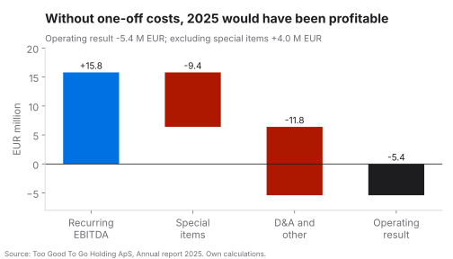
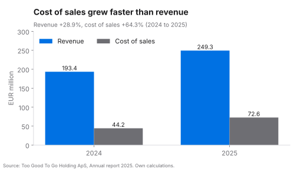
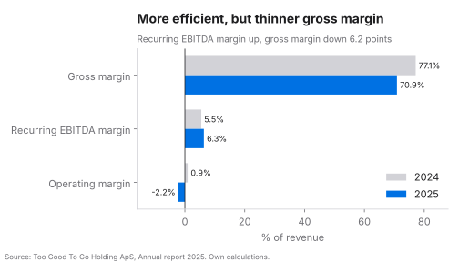

# Too Good To Go: a marketplace that gets paid before it pays

A financial analysis of Too Good To Go's business model, built on the group's consolidated annual report for 2025. The repository holds the data I extracted, the Python script that computes the ratios, and the charts used in the analysis.

This work continues my IB Extended Essay, which studied Too Good To Go's European growth and circular economy model between 2018 and 2024. The essay looked at strategy and mission; this project looks at the accounts.

## Key findings

**1. The underlying business is improving.** Revenue grew 28.9% to EUR 249.3 million and recurring EBITDA grew 49%, lifting the recurring EBITDA margin from 5.5% to 6.3%.

**2. The 2025 operating loss comes from one-off costs.** The operating result was EUR -5.4 million, but EUR 9.4 million of special items (mainly an internal reorganisation and new market launches) explain it. Excluding them, the operating result would have been EUR +4.0 million.



**3. Gross margin is shrinking.** Cost of sales grew 64%, more than twice as fast as revenue, and gross margin fell from 77.1% to 70.9%. The most likely cause is the Parcels business: for Surprise Bags the company only books its commission as revenue, while for Parcels it buys the product and books the full sale, along with its cost.





**4. Customers finance the operation.** Users pay when they reserve a bag, while merchants are paid later. The change in working capital accounts for 63% of 2025 operating cash flow, and the amount owed to partners (EUR 67.5 million) equals 84% of the cash balance. A large share of that cash is not the company's own money.

**5. Unit economics depend on density.** On a GBP 4 bag in the UK, the platform keeps GBP 1.09, about 27% of the price. A high take rate on a very small ticket only works when each merchant sells many bags and each user comes back.

**So what?** The question is no longer whether Too Good To Go will grow, but what kind of company it becomes. A marketplace without inventory, with gross margins above 70% and customers who pay upfront, deserves a platform valuation. A business that buys, stores and ships surplus stock looks much more like a distributor.

## Repository structure

```
data/
  key_figures.csv                    Revenue, cost of sales, EBITDA, special items, operating result
  cash_and_working_capital_2025.csv  Cash flow, cash, securities, payables to partners
  unit_economics_uk.csv              UK fee structure per Surprise Bag
analysis.py                          Computes the ratios and draws the charts
charts/                              Charts generated by analysis.py
output/metrics.csv                   Ratios generated by analysis.py
```

## How to run it

```bash
pip install -r requirements.txt
python analysis.py
```

The script prints the key metrics and regenerates every file in `charts/` and `output/`.

## Method and limitations

* Figures come from the consolidated annual report of Too Good To Go Holding ApS for 2025, filed with the Danish Business Authority, and are in EUR million unless stated otherwise.
* Gross margin is my own calculation: revenue minus cost of sales, divided by revenue. Recurring EBITDA is EBITDA before special items.
* Ratios are computed from figures rounded to one decimal, so some growth rates differ by 0.1 points from those computed on unrounded figures.
* The report does not split revenue or margin by product, so the link between Parcels and the falling gross margin is an inference from the accounting treatment, not a measured effect.
* UK fees come from Startups.co.uk (2025) and apply to that market only.

## Sources

* Too Good To Go Holding ApS (2026). *Annual report 2025*. Danish Business Authority.
* Young, H. (2025, 6 August). Too good to miss? Why cafés should embrace zero-waste apps. *Startups.co.uk*.
* Wu, N. and Duarte, V. (2024, 16 November). This startup brings in $162 million a year helping people find food at huge discounts. *CNBC Make It*.

## Author

**Alejandro Fernández Andreo**, BBA student at Universidad Autónoma de Madrid (Data Analytics for Business track).
[Website](https://afernandezandreo.com) · [LinkedIn](https://www.linkedin.com/in/afernandezandreo)

A longer written version of this analysis is in preparation for publication; a link will be added here once it is out.
